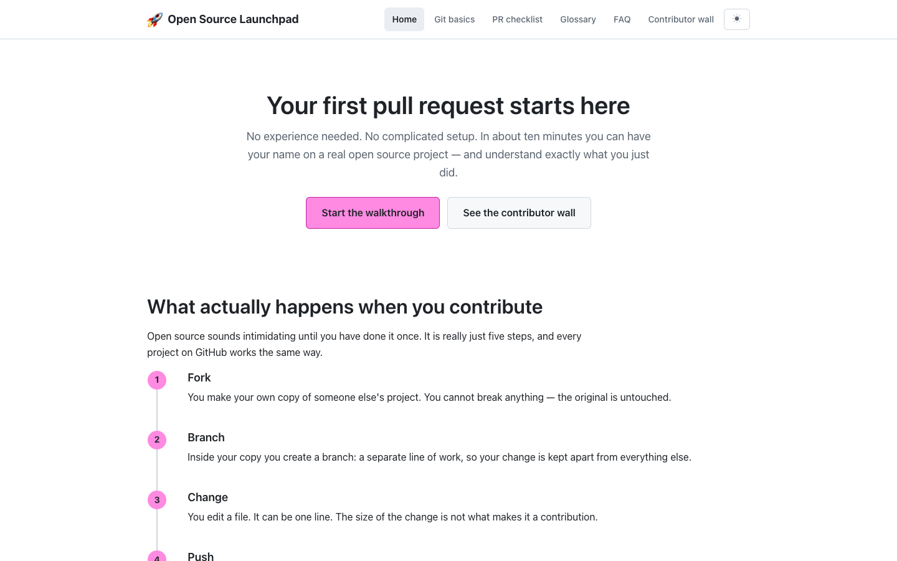
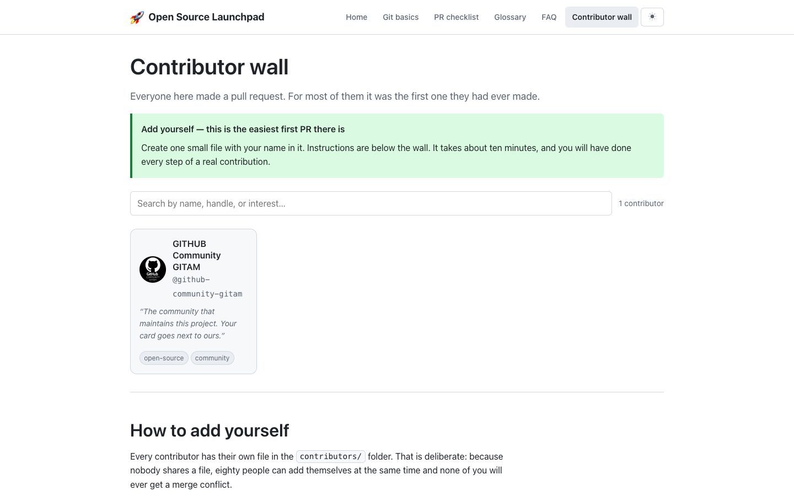
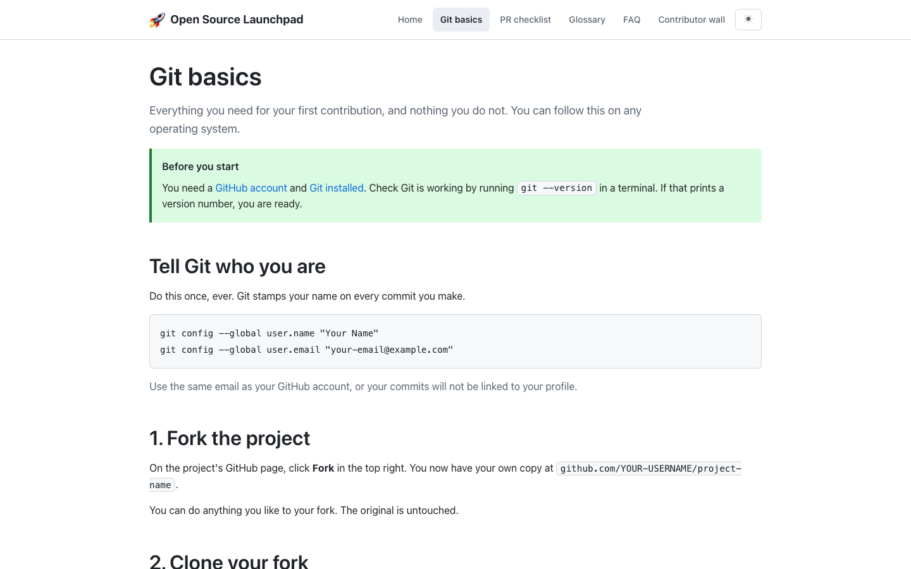
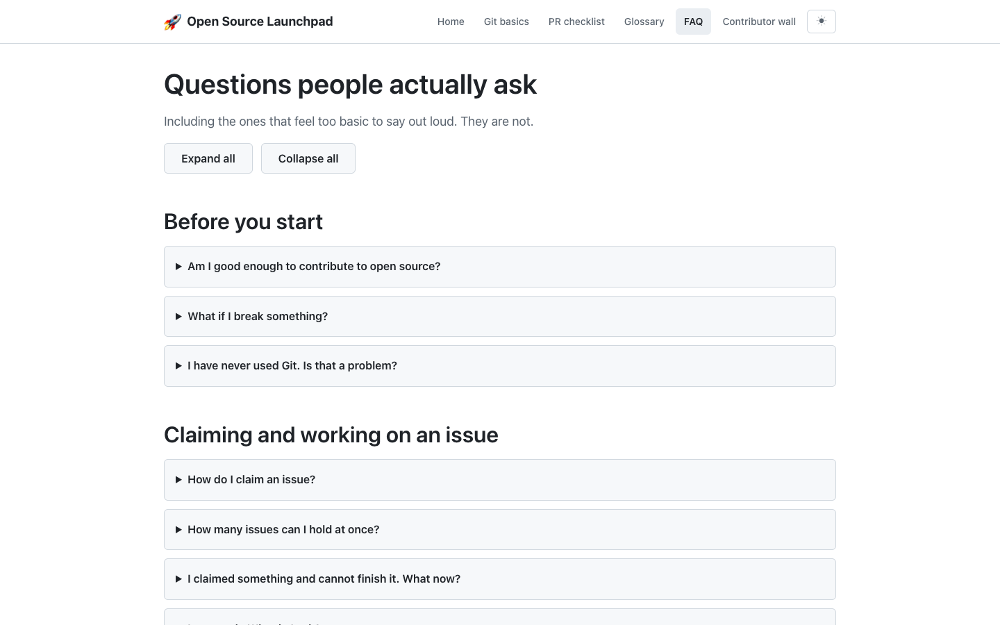
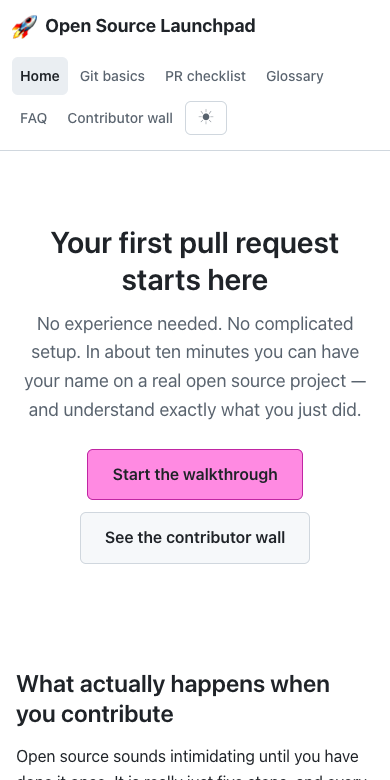

<h1 align="center">🚀 Open Source Launchpad</h1>

<p align="center">Your first pull request starts here.<br>
Plain HTML and CSS. No build step, no framework, no <code>npm install</code>.</p>

<p align="center">
  <a href="../../issues?q=is%3Aissue+is%3Aopen+label%3A%22good+first+issue%22"></a>
  
  
</p>

<p align="center"><a href="https://pushpam2404.github.io/open-source-launchpad/">Open the live site</a></p>

---

## What this is

A small website that teaches people how to make their first open source
contribution, and is itself the project they practise on. It has a walkthrough
of the Git workflow, a pre-PR checklist, a glossary, an FAQ and a contributor
wall. The open issues are sized for someone who has never opened a pull request
before; the issue list always shows what is available right now.

<p align="center">
  
</p>

<table>
  <tr>
    <td width="50%"></td>
    <td width="50%"></td>
  </tr>
  <tr>
    <td width="50%"></td>
    <td width="50%" align="center"></td>
  </tr>
</table>

## Run it locally

```bash
git clone https://github.com/pushpam2404/open-source-launchpad.git
cd open-source-launchpad
python3 -m http.server 8000
```

Open <http://localhost:8000>. That is the entire setup.

> **Why a server instead of double-clicking `index.html`?** Every page works
> either way *except* the contributor wall, which reads a JSON file. Browsers
> block reading local files from a `file://` page for security, so the wall
> would show an error. The one command above avoids that.

Any static server works — `npx serve`, VS Code Live Server, whatever you like.

---

## Where to look, and what to ignore

A repository looks like a lot of folders the first time you open one. Almost
none of them are yours to worry about. Here is the honest breakdown.

### 🎯 Your work goes here

| Folder / file | What is in it |
|---|---|
| **`contributors/`** | **One JSON file per person.** Adding yourself here is the easiest possible first pull request — copy `_TEMPLATE.json`, rename it to your username, fill in your name. |
| **The `.html` files at the top level** | The pages of the site: `index.html`, `git-basics.html`, `pr-checklist.html`, `glossary.html`, `faq.html`, `wall.html`, plus `404.html`. Many beginner issues are "fix the text / add a link / add alt text" and happen in exactly one of these. |
| `css/` | How the site looks. Start with `theme.css` — every colour and spacing value in the whole site is a variable in that one file. |
| `js/` | Small scripts, one job each: the dark-mode switch, the copy buttons on code blocks, the contributor wall, the glossary and the FAQ. Intermediate issues live here. |
| `data/glossary.json` | The glossary entries. Each one is an object with a term and a definition. |

### 📖 Worth reading, not editing

| File | Why |
|---|---|
| `CONTRIBUTING.md` | The workflow: claim an issue, branch, commit, open a PR. |
| `contributors/README.md` | Exactly how to add yourself to the wall. |

### 🙈 Safe to ignore completely

You will never need to touch any of these, and nothing in your issue will
require it.

| Thing | What it actually is |
|---|---|
| `.github/` | Robots. The checks that run on your PR, the issue templates, the bot that assigns you an issue when you comment `/claim`. Maintainer territory. |
| `scripts/build_contributors.py` | A helper a GitHub Action runs by itself after your PR merges. You do not run it. |
| `contributors/index.json` | **Generated automatically — never edit it by hand.** A robot rebuilds it from everyone's individual files. |
| `.htmlvalidate.json` | Settings for the HTML checker. |
| `.gitignore` | A list of files Git should not track. |
| `LICENSE`, `SECURITY.md`, `CODE_OF_CONDUCT.md` | Standard paperwork every open source project carries. |
| `docs/screenshots/` | The pictures used in this README. |
| `robots.txt`, `sitemap.xml` | For search engines. |

**The short version:** open an issue, it tells you the file. That file is
almost always one `.html` page or one `.css` file. Everything else is scenery.

---

## 🎃 Contributing

**This repository exists so you can make your first pull request.**

### The gentlest possible start: add yourself to the wall

1. Copy `contributors/_TEMPLATE.json` to `contributors/your-username.json`
2. Fill in your name
3. Open a pull request

Ten minutes, and you will have done every step of a real contribution: fork,
clone, branch, commit, push, PR. Full instructions on the
[contributor wall page](wall.html).

### Then pick a real issue

1. Browse the [open `good first issue` list](../../issues?q=is%3Aissue+is%3Aopen+label%3A%22good+first+issue%22). Anything marked `status: claimed` already has an owner
2. Comment **`/claim`** — a bot assigns it to you within seconds
3. Read [CONTRIBUTING.md](CONTRIBUTING.md)
4. Open a PR with `Closes #<issue number>`

Every issue names the exact file to open, what "done" looks like, and how to
check your work. If one does not, that is our mistake — tell us.

---

## Full file tree, for reference

Everything marked *ignore* is infrastructure. It is listed only so that nothing
in the repo looks mysterious.

```
open-source-launchpad/
├── index.html            # the landing page
├── git-basics.html       # fork → clone → branch → commit → push → PR
├── pr-checklist.html     # run through this before opening a PR
├── glossary.html         # plain-English Git and GitHub terms
├── faq.html              # common questions, expandable answers
├── wall.html             # the contributor wall
├── 404.html
├── robots.txt
├── sitemap.xml
├── css/
│   ├── theme.css         # all colours and spacing live here, as variables
│   ├── base.css          # element defaults and resets
│   ├── layout.css        # header, nav, footer, grid, print styles
│   └── components.css    # cards, buttons, callouts, the wall
├── js/
│   ├── theme-toggle.js   # light/dark, remembered per browser
│   ├── copy-code.js      # copy buttons on code blocks
│   ├── wall.js           # loads and filters the contributor wall
│   ├── glossary.js       # loads and filters the glossary
│   └── faq.js            # expand / collapse all on the FAQ
├── data/
│   └── glossary.json     # glossary entries
├── contributors/
│   ├── _TEMPLATE.json    # copy this
│   ├── index.json        # generated — do not edit
│   └── <username>.json   # one file per person
├── scripts/
│   └── build_contributors.py   # ignore — a robot runs this for you
├── docs/screenshots/     # ignore — README pictures
├── .github/              # ignore — CI checks, issue templates, bots
├── .htmlvalidate.json    # ignore — HTML-checker settings
├── .gitignore            # ignore
├── LICENSE               # ignore — MIT
├── SECURITY.md           # ignore
└── CODE_OF_CONDUCT.md    # ignore
```

### One file per contributor, on purpose

Each person adds `contributors/<their-handle>.json`. Because nobody shares a
file, **eighty people can add themselves during a two-hour event without a
single merge conflict.** A GitHub Action rebuilds `contributors/index.json`
after each merge.

This is a real technique, not a teaching exercise — the same pattern shows up in
changelog folders and infrastructure configs anywhere a large team edits one
project.

---

## Editing the site

**Changing a colour?** Edit `css/theme.css`. Every colour in the project is a
variable defined there, and there is a dark-theme value right below the light
one. Change both.

**Adding a page?** Copy the `<head>`, header, and footer from an existing page,
add your page to the nav in every other page, and add `aria-current="page"` to its
own nav link.

**Adding a component?** It goes in `css/components.css`, and it uses the
variables from `theme.css` rather than hard-coded colours.

---

## What CI checks, and what can actually stop your PR

These checks run on every pull request, and each one only fires on something
genuinely broken:

| Blocks the merge | Looks for |
|---|---|
| **contributor files** | Invalid JSON, a filename that does not match the handle, an over-long quote |
| **HTML** | A tag that was never closed, malformed markup |
| **accessibility** | Images with no `alt`, a missing `lang`, `<title>`, or viewport tag |
| **internal links** | An `href` or `src` pointing at a file that does not exist |

**Style is never a blocker.** Quote marks, tag casing, heading order and similar
house-style points appear as *warnings* in the log and are ignored by the gate.
If the log says `warning`, it cannot stop your pull request — only `error` can.

This is deliberate. Nobody's first contribution should be rejected by a robot
over a style preference.

Check the first one yourself before pushing:

```bash
python3 scripts/build_contributors.py --check
```

---

## Hosting

The site is published to GitHub Pages by the `Deploy to Pages` workflow on
every push to `main`, and once a day on a schedule. The schedule exists because
pull requests merged by the auto-merge workflow do not trigger a push
workflow (GitHub does not start runs for events caused by the built-in token),
so without it the live site would lag behind `main`.

Maintained by **OS & DevX**, GITHUB Community GITAM. The October kickoff and
debug clinics have already taken place; the issues are still open to anyone.

Also worth a look: **[terminal-arcade](https://github.com/pushpam2404/terminal-arcade)**,
our Python mini-games project, if you would rather write Python than HTML.

## License

[MIT](LICENSE)
